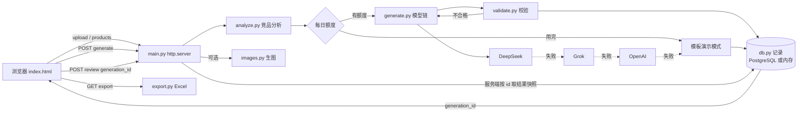

# 亚马逊 Listing 与广告方案生成器（amazon-listing-agent）

一个面试演示项目：基于**模拟数据**做竞品分析，调用大模型生成亚马逊美国站 Listing（标题、五点、后台搜索词）和广告方案，经脚本校验后导出 Excel，并支持提交人工审核。

- 在线演示：<https://novaryn.cn/amazon-agent/>
- 后端：Python 标准库 `http.server`，唯一必需依赖 `openpyxl`
- 前端：单文件 `static/index.html`，所有接口为相对路径，可挂在任意 URL 前缀下

> 不爬取亚马逊、不调用第三方数据 API、不向亚马逊上传任何内容。

## 功能

| 功能 | 说明 |
|---|---|
| 竞品分析 | 前 10 竞品的评论数、均价、关键词缺口，计算竞争强度（低/中/高） |
| 大模型生成 | 结构化 JSON 输出 Listing + 广告组（≤15 个，含匹配方式、建议竞价、预算占比） |
| 脚本校验与重试 | 标题 ≤200 字符、5 条五点各 ≤250 字符、后台词 ≤250 字节且不重复标题词、违禁词；不合格把错误反馈给模型重试 |
| 导出 Excel | 竞品分析 / Listing / 广告方案三个工作表 |
| 人工审核 | 「提交人工审核」写入审核记录，保存提交时的生成结果快照 |
| 文档上传 | 拖拽或点击上传 Excel / CSV / JSON（≤2MB），提供模板下载；也可直接用示例数据 |
| 多模型容灾 | DeepSeek → Grok(xAI) → OpenAI → 模板「演示模式」；页面可用下拉框指定优先模型 |
| 商品展示图（可选） | 勾选后用 OpenAI 生图模型出白底主图 + 场景图，标注「AI 示意图，非实拍」 |
| 记录审计 | 每次生成记录时间、ASIN、实际模型/演示模式、容灾链路、校验结果、重试次数、耗时、token |
| 每日额度 | 真实模型调用与生图分别按天（Asia/Shanghai）限额，超额自动降级为演示模式 |

## 架构与数据流



## 目录结构

```
main.py              HTTP 服务器与路由（products / models / template / upload / generate / review / export / image）
src/analyze.py       竞争强度、关键词缺口、均价
src/generate.py      模型链路（OpenAI 兼容 chat/completions，JSON 输出）+ 校验重试 + 模板兜底
src/validate.py      Listing 规则校验
src/export.py        Excel 导出
src/upload.py        上传文件解析（xlsx/csv/json，只在内存中保留）
src/images.py        OpenAI 生图、本地保存、7 天清理
src/db.py            记录与额度：设置 PGHOST 时写 PostgreSQL，否则用内存
data/mock_data.json  虚构示例数据
sql/schema.sql       可选的 PostgreSQL 建表脚本
static/index.html    前端页面
```

## 本地运行

```bash
pip install -r requirements.txt
cp .env.example .env      # 按需填写 key；不填也能以演示模式运行
set -a; . ./.env; set +a
python3 main.py --port 8765
```

打开 <http://127.0.0.1:8765/>（只绑定 127.0.0.1）。URL 参数：`?asin=B0DEMO5678&auto=1` 自动生成；`&fail=1` 故意制造超长五点、不调用模型，只演示校验不通过（不演示重试；重试只在真实模型输出未通过校验时发生）。

如需持久化记录：`pip install psycopg2-binary`，执行 `sql/schema.sql`，再设置 `PGHOST/PGDATABASE/PGUSER/PGPASSWORD` 等 libpq 环境变量。

## 环境变量

| 变量 | 默认 | 说明 |
|---|---|---|
| `DEEPSEEK_API_KEY` / `XAI_API_KEY` / `OPENAI_API_KEY` | 空 | 配了哪个 key 才启用哪个模型；都不配则只有演示模式 |
| `MODEL_CHAIN` | `deepseek,xai,openai` | 容灾顺序 |
| `DEEPSEEK_MODEL` / `XAI_MODEL` / `OPENAI_MODEL` | `deepseek-flash` / `grok-4.3` / `gpt-4.1-mini` | 各家模型名 |
| `<NAME>_BASE_URL` | 各家官方地址 | 可指向兼容网关 |
| `<NAME>_TIMEOUT_SECONDS` | `60` | 单个模型超时 |
| `MAX_TOKENS` | `3000` | 生成上限 |
| `IMAGE_MODEL` / `IMAGE_QUALITY` | `gpt-image-1.5` / `low` | 生图模型与质量 |
| `IMAGE_DIR` | `./images` | 生成图片保存目录 |
| `DAILY_GEN_LIMIT` / `DAILY_IMAGE_LIMIT` | `100` / `100` | 每日真实模型调用 / 生图张数上限 |
| `MAX_CONCURRENT` | `4` | 同时进行的生成数 |
| `PORT` | 自动选空闲端口 | 也可用 `--port` |
| `PGHOST` 等 | 空 | 设置后记录写入 PostgreSQL |

所有 key 只从环境变量读取，代码和仓库中不包含任何密钥。

## 关键设计取舍

- **为什么做多模型容灾**：单一模型会超时、限流或返回坏 JSON（实测 DeepSeek 偶发格式错误）。统一走 OpenAI 兼容接口，失败按链路切换下一个，全部失败退回模板，保证演示永远有结果；记录中写明最终用了哪个模型及失败原因。
- **为什么服务端按 `generation_id` 取结果**：提交审核和导出时，前端只传 `generation_id`，服务端从记录中取当时的生成结果做快照，避免前端篡改内容后冒充模型产出，审计记录可信。
- **校验与重试**：大模型不可靠地遵守长度/字节/违禁词规则，所以用确定性脚本校验，把具体失败项反馈给模型重试，仍不合格则如实标注，不伪装通过。
- **成本控制**：每日额度在数据库里原子占用（`INSERT ... ON CONFLICT ... WHERE used+n<=limit`），仅配置数据库时重启不清零；额度出错时保守按"无额度"处理，不调用付费模型；生图默认关闭、需手动勾选并单独限额；并发用信号量限制。
- **零依赖部署**：标准库 HTTP 服务 + 相对路径接口，方便反向代理挂到子路径。

## 免责声明

本项目所有商品、竞品、关键词数据均为虚构的模拟数据，仅用于技术演示与面试交流，不构成任何运营建议。生成的商品图为 AI 示意图，非实拍。

## License

MIT

## 预算与出价参考（估算，代码计算）

广告方案页顶部的「预算与出价参考」由 `src/adcalc.py` 纯代码计算，不交给大模型；广告组的「建议竞价/预算占比」统一用这里的结果覆盖，避免出现两套数字。

- 单件利润 = 售价 − 成本 − 售价 × fee_rate；利润率 = 单件利润 / 售价
- 盈亏平衡 ACoS = 利润率；目标 ACoS = 盈亏平衡 × 70%
- 建议最高出价 = 售价 × 目标 ACoS × 转化率；起步出价 = 最高出价 × 0.7
- 建议日预算 = 最高出价 × 预计每日点击（默认 30）；预计日订单 = 点击 × 转化率
- 利润率 ≤ 0 时不给出价，提示"该售价下不盈利，不建议投广告"
- 同时给出我方售价相对竞品中位价（来自 comp_price）的位置

上传表格新增 3 个可选列：`cost`（进货成本）、`fee_rate`（佣金+配送费率 0–0.8）、`cvr`（转化率 0.01–0.5）。留空时使用示例假设（成本=售价×30%、fee_rate=0.30、cvr=0.10），页面对每个输入标注「表格提供 / 示例假设」。这些是按假设推算的估算值，不是真实广告数据，上线后应用实际 ACoS 校准。单元测试：`python3 tests/test_adcalc.py`。
